# Deploy a 3-Tier Application on a Custom AWS VPC (Nginx Only)

**Module:** AWS VPC, Subnets, NAT Gateway & EC2  
**Total Marks:** 100 + 10 (Bonus)  
**Author:** Tsourov (tsourov211-eng) | Ostad DevOps Cohort  

---

## 1. Project Objective

The objective of this assignment is to deploy a secure and scalable **3-tier web application** (Web, Application, and Database) on AWS within a custom Virtual Private Cloud (VPC). 

Key architectural requirements:
* **Nginx is the sole public entry point** for all incoming user traffic.
* **Web Tier (Public Subnet):** EC2 instance running Nginx serving static HTML frontend and reverse-proxying API calls to the application server.
* **Application Tier (Private Subnet):** EC2 instance running a backend API (Node.js / Express) that interacts with the database. Runs as a systemd service to survive reboots.
* **Database Tier (Private Subnet):** EC2 instance running MariaDB/MySQL, accessible only from the application tier.
* **Strict Security Group Chaining:** Each tier only accepts inbound traffic from the tier directly before it.

---

## 2. Architecture Diagram

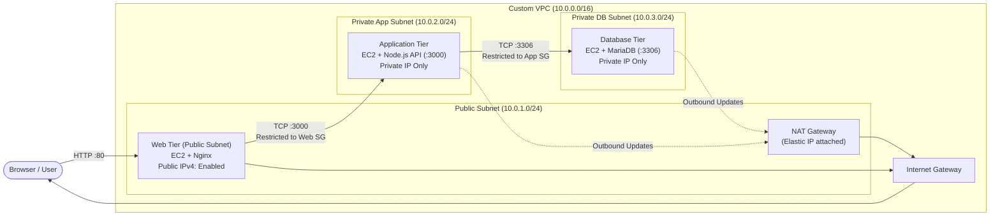

---

## 3. Network & Security Architecture

### Network Configuration

| Resource | Subnet CIDR | Type | Public IP | Route Destination (`0.0.0.0/0`) |
| :--- | :--- | :--- | :--- | :--- |
| **Web Tier** | `10.0.1.0/24` | Public | Yes (Elastic/Auto-assign) | Internet Gateway (`igw-*`) |
| **App Tier** | `10.0.2.0/24` | Private | No | NAT Gateway (`nat-*`) |
| **Database Tier** | `10.0.3.0/24` | Private | No | NAT Gateway (`nat-*`) |

### Security Group Ingress Chaining

1. **Web Security Group (`ostad-3tier-web-sg`):**
   - Inbound: **TCP Port 80** from `0.0.0.0/0` (HTTP internet access).
2. **Application Security Group (`ostad-3tier-app-sg`):**
   - Inbound: **TCP Port 3000** restricted solely to `ostad-3tier-web-sg` (Source Security Group).
   - Direct internet inbound access is completely blocked.
3. **Database Security Group (`ostad-3tier-db-sg`):**
   - Inbound: **TCP Port 3306** restricted solely to `ostad-3tier-app-sg` (Source Security Group).
   - Direct web and internet inbound access are completely blocked.

---

## 4. Tier Implementation Details

### Web Tier (Nginx Reverse Proxy)
* Serves a responsive To-Do List frontend from `/usr/share/nginx/html/index.html`.
* Nginx configuration `/etc/nginx/conf.d/3tier.conf` proxies all `/api/` traffic to the private application server at `http://10.0.2.13:3000`.

### Application Tier (Node.js API)
* REST API built with Express.js (`app/server.js`) and `mysql2`.
* Exposes `/api/health` and `/api/records` (GET & POST).
* Configured as a **systemd service** (`/etc/systemd/system/todo-api.service`) with `Restart=always` so the API automatically starts and persists upon EC2 reboots.

### Database Tier (MariaDB)
* MariaDB 10.5 server running on private IP `10.0.3.12`.
* Stores persistent records in `todoapp.records` (`id`, `title`, `created_at`).
* Application user `'todoapp'@'10.0.2.%'` has least-privilege DML access (`SELECT, INSERT, UPDATE, DELETE`) scoped strictly to the application subnet.

---

## 5. Verification Screenshots

### A. Custom VPC & Subnets
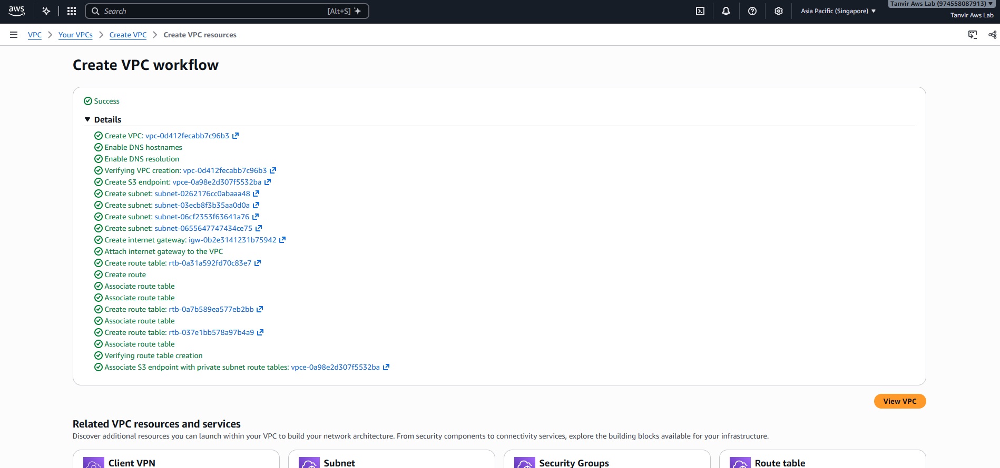
*Figure 1: Custom VPC successfully created.*

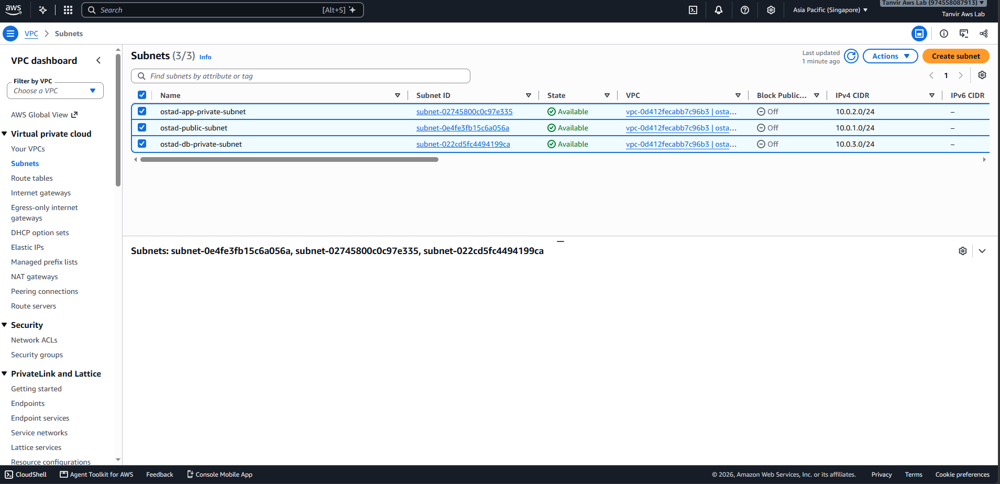
*Figure 2: Public and Private Subnets across availability zones.*

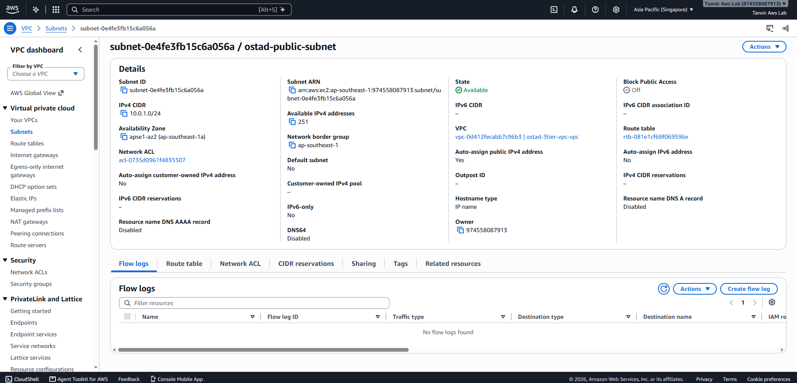
*Figure 3: Public Subnet settings and auto-assign public IPv4 configuration.*

---

### B. Routing & NAT Gateway
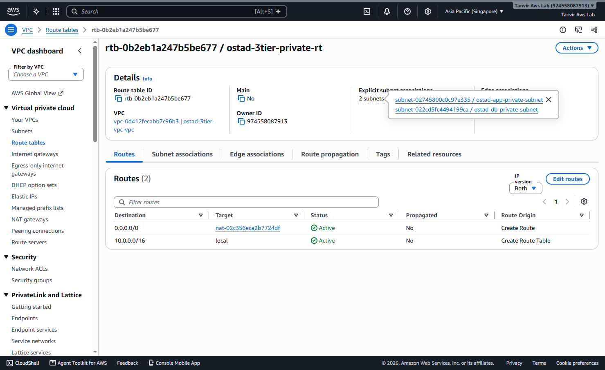
*Figure 4: Private Route Table routing 0.0.0.0/0 outbound traffic through the NAT Gateway.*

---

### C. Security Groups Configuration
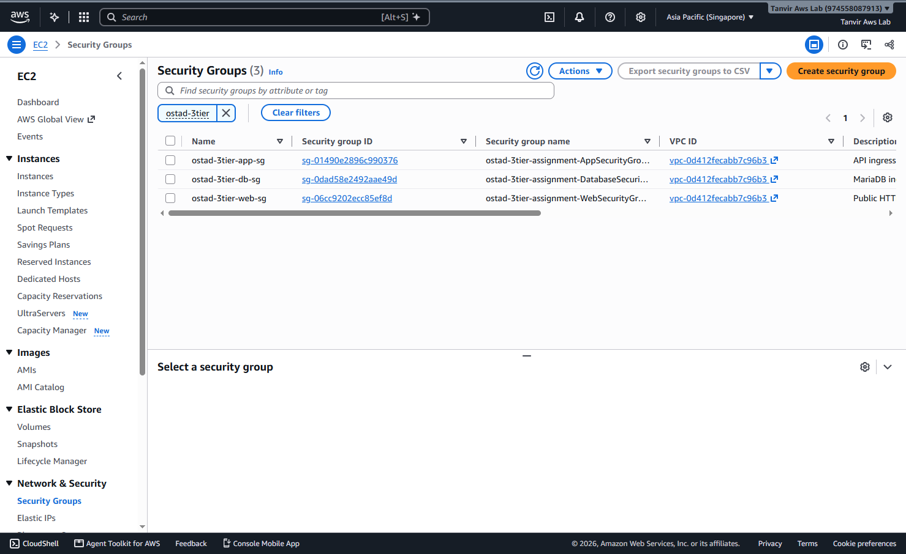
*Figure 5: Overview of Web, App, and Database Security Groups.*

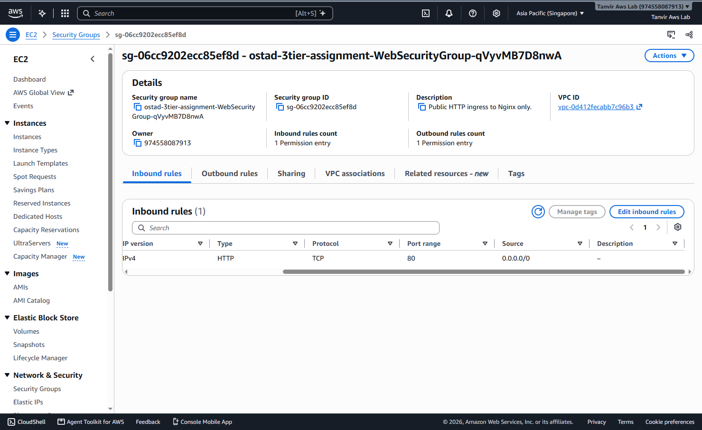
*Figure 6: Web Security Group allowing inbound HTTP port 80 from anywhere.*

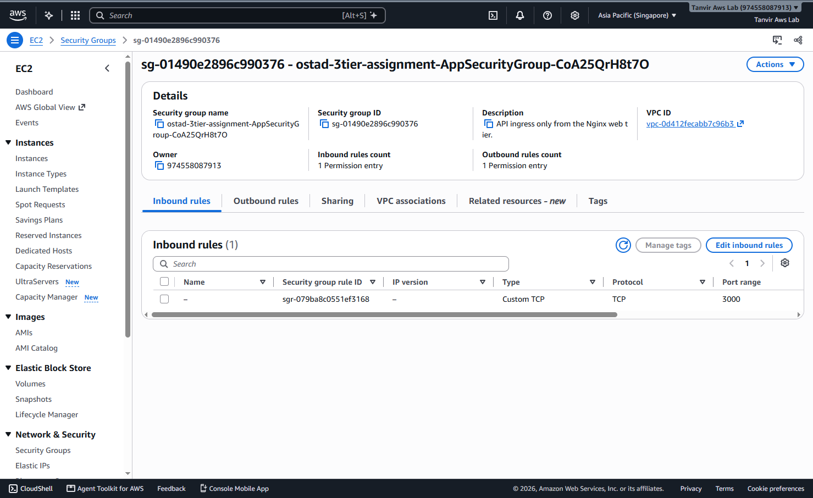
*Figure 7: App Security Group restricting inbound port 3000 exclusively to the Web Security Group.*

---

### D. EC2 Instances
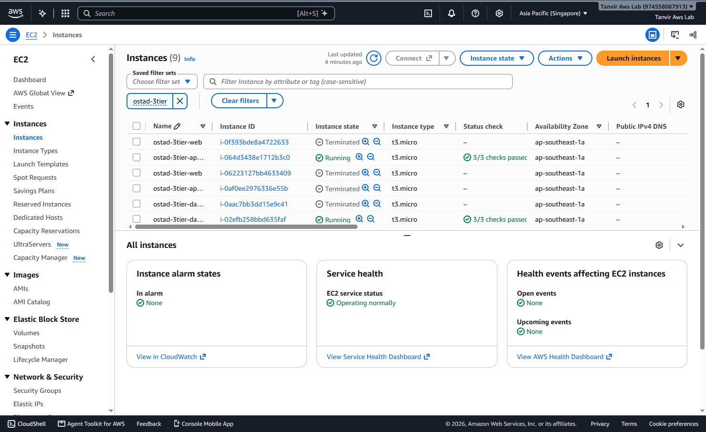
*Figure 8: Running EC2 instances (Web in public subnet; App and Database in private subnets with private IPs only).*

---

### E. End-to-End Working Application
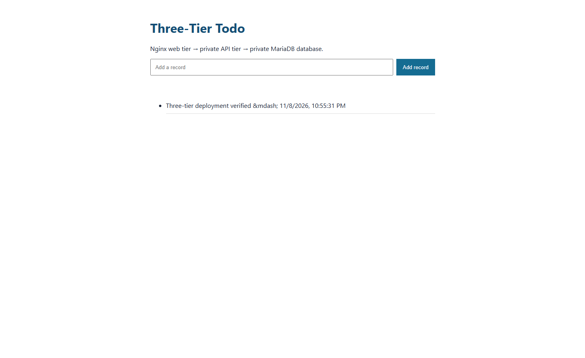
*Figure 9: To-Do Application accessed through Nginx public IP, showing successful record creation and persistence.*

---

### F. Bonus: Infrastructure as Code Automation (+10 Marks)
To achieve the bonus points, the deployment and setup of all three tiers are automated using an AWS CloudFormation template ([`cloudformation/3-tier.yaml`](cloudformation/3-tier.yaml)) with EC2 UserData automation scripts.

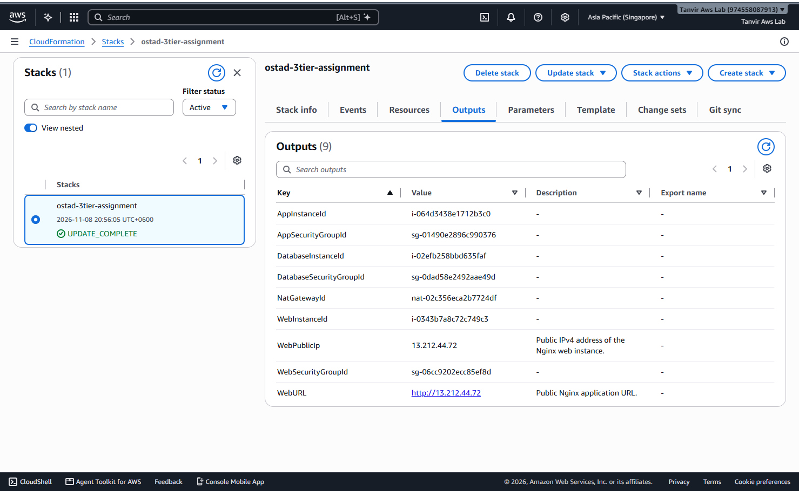
*Figure 10: Successful automated deployment via AWS CloudFormation with exported outputs.*

---

## 6. Problems Encountered and Solutions

1. **HTTP 502 Bad Gateway on API calls:**
   - *Problem:* When first testing the application through Nginx, the UI loaded but requests to `/api/records` returned `502 Bad Gateway`.
   - *Cause:* The Node.js application was trying to boot before MariaDB had initialized, causing startup failure, and App Security Group needed explicit source chaining.
   - *Fix:* Confirmed App Security Group allowed port 3000 from the Web Security Group. Added a connection retry loop in `server.js` so Node waits for the database before listening.

2. **Private EC2 Instances Needing Outbound Internet for Dependencies:**
   - *Problem:* App and DB EC2 instances have no public IPs and could not download required packages (`nodejs`, `npm`, `mariadb-server`).
   - *Cause:* Private subnets cannot directly route to the Internet Gateway.
   - *Fix:* Associated the private subnets with a private route table containing a default route (`0.0.0.0/0`) targeting the NAT Gateway in the public subnet.

3. **Ensuring Backend Process Survives Reboot:**
   - *Problem:* Assignment required the backend API to remain running after an instance reboot.
   - *Fix:* Packaged the Node.js API into a `systemd` service (`todo-api.service`) with `Restart=always` and enabled it via `systemctl enable --now todo-api`.

---

## 7. Conclusion

This project successfully implements a production-style, secure 3-tier web architecture on a custom AWS VPC:
* **Strict Tier Isolation:** The database and backend application instances remain strictly protected within private subnets without direct internet exposure.
* **Single Public Entry Point:** Nginx acts as the secure entry gateway, handling client requests and reverse-proxying API calls securely.
* **High Availability & Persistence:** Systemd ensures the API stays running across reboots, and MariaDB ensures persistent data storage for all records.
* **Automation:** Leveraging CloudFormation and EC2 UserData provides reproducible, error-free infrastructure deployment that fulfills the bonus criteria.
